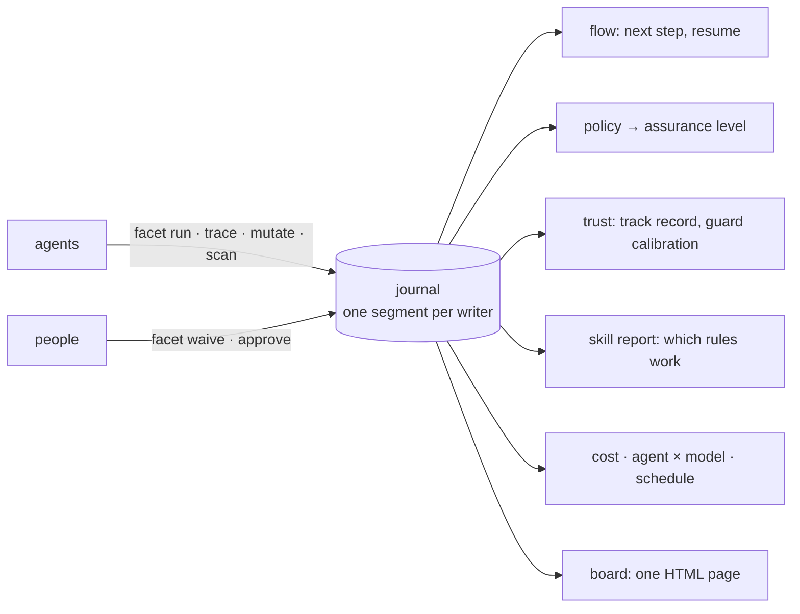

# facetkit

<p align="center">
  
</p>

[🇬🇧 English] | [🇵🇱 Polski](README.pl.md)

[](https://www.npmjs.com/package/facetkit)
[](LICENSE)
[](https://nodejs.org/)
[](https://github.com/Anctoster/facetkit/stargazers)

**Evidence-first engineering for teams of AI agents.** Skills that are small enough to follow, tools that measure instead of asking, and a journal from which the state of the work, its cost, and how far its result can be trusted are computed — not asserted.

No dependencies. Node 20+. Works with any agent that can run a shell command; ships as a Claude Code plugin. Code analysis understands JavaScript/TypeScript, Python, Go and Java.


> **Status: 0.7.1, experimental.** The tools are tested (<!-- count:tests -->292<!-- /count --> tests and a guard benchmark of <!-- count:benchmark -->22<!-- /count --> adversarial cases; the kit is run on itself, see [docs/dogfood.md](docs/dogfood.md)). The skills are **<!-- count:untested -->69<!-- /count --> untested hypotheses** about agent behaviour — listed one by one in [HYPOTHESES.md](HYPOTHESES.md), each with the trial that would confirm or kill it. Running a trial is the most useful thing you can contribute: `facet hypotheses --next` says which to try first, the pinned [Trial board](docs/trial-board.md) issue says who is testing what, and `HYPOTHESES.md` shows every reported result.

## 🔬 FacetKit Community Research Program

Help us discover what actually makes AI agents
more reliable, effective and verifiable.

Join the FacetKit Community Research Program.

[Explore Research Hub](docs/research/README.md)
## Start here

**New to FacetKit?** Three short guides, each usable on its own: **[Quick start](docs/quick-start.md)** — ten minutes on your own code, no agents → **[Project integration](docs/project-integration.md)** — one rule for your own agent, or only the agents you choose (`facet init --agents slice-builder,proof-inspector`) → **[GitHub integration](docs/github-integration.md)** — a check and a comment on every pull request (`facet init --github`).

## Try it in five minutes

```bash
git clone https://github.com/Anctoster/facetkit && cd facetkit
npm run demo:proof
npx facetkit demo
```

An agent changes code; another run checks it; a proof pack ties the verdict to those exact sources; a second party verifies it from one file; one edited line later the proof says STALE, and an edited bundle says TAMPERED. Nothing is installed and nothing outside a temp folder is touched. Where this is going: [ROADMAP.md](ROADMAP.md) · the map of the code: [ARCHITECTURE.md](ARCHITECTURE.md) · first contributions: [GOOD_FIRST_ISSUES.md](GOOD_FIRST_ISSUES.md).

## The problem

Agents finish work and say it is done. Between that sentence and a result you can rely on there are questions nobody answers by default:

- **Was it checked, or only claimed?** A test that passes may never have been able to fail. A reviewer agent may have quoted the builder's report.
- **What happens when the session ends mid-task?** The next one re-reads everything, or guesses.
- **What did it cost, and would a cheaper model have done?** Nobody knows, so everything runs on the dearest one.
- **Does the team get better?** Prompts grow after every incident and are never asked to prove that the addition helped.
- **How far can I trust the result — and the team?** "All tests pass" is not an answer.

Frameworks answer these with more agents, a runtime, or a dashboard of model-graded scores. facetkit answers them with three plain things: **rules with a check and a stop**, **tools that produce evidence**, and **one append-only journal** that everything else is computed from.

## What you get

### 1. Skills as facets

A skill is cut into **facets**: one rule each, at most 170 words, with four parts — `Do`, `Check` (what an observer can verify), `Stop` (a number, and what to do on reaching it), `Why`. An agent does not load skills; it loads a **loadout**: the facets its role needs in this phase, from several skills, under a word budget.

```bash
facet list                                             # 14 skills, 69 facets, with their word cost
facet compose --role spec-falsifier --phase red        # a loadout
facet compose --take slice-seams:contract-pin          # one more rule, on demand
facet audit --prior ../other-skills                    # structure, duplicates, similarity to prior art, budgets
```

| Skill | What it changes |
|---|---|
| `spec-trace` | the request becomes numbered clauses; how each is refuted is decided before any test; every test claims a clause |
| `falsifiable-tests` | a test counts only after it failed for the right reason, survived sabotage and killed mutants |
| `slice-seams` | a vertical slice is not done until neighbours' tests, a shared contract example and one real thread pass |
| `thrift-loop` | commands run through a meter; output stays on disk; budgets are hard stops; work goes to the cheapest capable model |
| `anchored-handoff` | code references carry a content hash; the receiver re-reads only what drifted |
| `doc-receipts` | documentation is read once per library version and leaves a receipt |
| `evidence-browser` | browser proof is a digest of numbers and rule findings, not a screenshot |
| `claim-ledger` | every claim is paired with the command that could refute it |
| `journal-flow` | the coordinator asks what is next instead of remembering; work resumes from checkpoints |
| `earned-memory` | store only what cost you something; recall by territory; stale means re-check |
| `hindsight-retro` | act on one-sided evidence; charge late defects to their origin; put every change on trial |
| `assured-work` | the policy closes the item; exceptions are named human decisions; reports state the level |
| `skill-sense` | read the diagnosis before touching a rule; give rules a footprint; graduate the ones that work but are ignored into tools |
| `facet-forge` | how to add, test, measure and retire facets |

### 2. Tools that measure

| Command | What it gives an agent |
|---|---|
| `facet run -- CMD` | exit code, signal lines, tail; full log on disk; exit 3 when a budget is spent or a command fails three times in a row |
| `facet trace --spec S --tests T` | clauses nothing verifies; tests that verify nothing asked for |
| `facet mutate --files F --test "CMD"` | bounded mutation probe: which deliberate breakages no test noticed |
| `facet seams` | consumers, providers and neighbour tests of a change |
| `facet capsule seal\|verify` | hash-anchored code references in handoffs |
| `facet scan` | secrets in added lines, forbidden paths, new dependencies, dangerous commands, injected instructions |
| `facet atlas card FILES` | what a file offers, who uses which name, which tests stand behind it, what changes with it — in ≤ 220 words |
| `facet receipt`, `facet ui`, `facet read`, `facet ledger` | documentation receipts, browser digest, bounded reads, the meter |

### 3. One journal, many views

Every command reads an append-only, hash-chained journal, computes, and exits. There is no daemon, database or runtime.



| Question | Command |
|---|---|
| What do I do now? | `facet flow next` — one action: agent, mode, model, rules. Steps cannot be skipped. |
| The session died mid-step. | `facet flow next` again — a ten-line resume card built from checkpoints (`facet note`). |
| What does the team know about this code? | `facet mem recall --files …` — anchored, territory-bound, retired when it stops helping. |
| What happened? What looks wrong? | `facet timeline` |
| Where did the tokens go? | `facet cost import TRANSCRIPT`, `facet cost report` |
| Which agent is good on which model? | `facet eval matrix`, `compare`, `replay`, `judge` |
| How do we improve? | `facet retro report`, `hindsight`, `adopt` |
| **Which rules work, why, and what to do about each?** | `facet skill report`, `facet skill coverage` |
| Will we make the dates? | `facet plan` |
| **May this item close? How far can it be trusted?** | `facet assure`, `facet attest`, `facet trust` |
| Show me everything. | `facet board` — one self-contained HTML page |

## How far can the result be trusted?

This is the part that makes facetkit more than a set of agents. An item is closed by a **policy over recorded evidence**, and receives an **assurance level**:

| Level | The record shows |
|---|---|
| L0 claimed | agents reported the work done |
| L1 reproduced | an agent that did not produce the work re-ran the checks; no step skipped; history intact; scan clean |
| L2 specified | every requirement is claimed by a test or scenario; project checks pass on the final state |
| L3 falsified | ≥ 80 % of planted breakages of the changed code were noticed by tests; neighbour tests ran |
| L4 calibrated | nothing waived, and the guards themselves were shown to catch planted defects |

```text
$ facet assure --item P07
P07: L2 specified · gate (needs L2): ALLOW
  ✓ L1 verdict          PASS      an inspector re-ran the checks and passed the item
  ✓ L1 independent      true      the agent that judged did not produce the work
  ✓ L2 specified        trace 9/9 every requirement is claimed by a test or an acceptance scenario
  ✗ L3 falsified        mutate 0.6 NOT MET — at least 80 % of deliberate breakages … were noticed by tests
```

- Evidence is written by the tool that measured it, never typed by the agent it judges, and goes **stale** when the code changes afterwards.
- An exception is a **waiver in a person's name**; it opens the gate, caps the level and stays in the attestation.
- `facet trust` states the team's track record with an interval — *"of 20 closed items 1 later needed a fix; with about 80 % confidence at most 13 % carry a defect that is found later"* — and whether the guards have ever been tested with a planted defect (`facet canary`).

A level says which evidence exists. It does not say the evidence is enough for your risk, and it cannot count defects nobody found. See [docs/governance.md](docs/governance.md).

## Which skills actually work?

Every facet is treated as a hypothesis and measured three ways: **exposure** (was it in what the agent read, or deliberately withheld), **adherence** (did the agent leave the rule's *footprint* — a tool used, evidence recorded, a red run before a green one), and **effect** (did the failure mode it guards against become rarer).

```text
$ facet skill report
slice-seams:neighbour-run — works when followed, mostly ignored
    exposed 24 · followed 21% (5/24) · clean with it 100% (5/5) · without 53% (10/19) · effect +47 points
    → graduate it: turn its Check into a tool or a policy rule, then shorten the prose
thrift-loop:hard-caps — followed, no measurable effect
    exposed 16, withheld 8 · followed 100% (16/16) · clean with it 100% · without 100%
    → retire it, or the models have outgrown it: confirm with two replays without it, then delete
```

Optional, seeded **withholding** turns correlation into an experiment (never for safety rules, off by default). `facet skill coverage` lists failure modes with incidents and no guarding rule, each with a trial harvested from the real incident. The intended direction is that a collection gets *shorter*: rules that matter graduate into tools, rules that do not are deleted. See [docs/skill-intelligence.md](docs/skill-intelligence.md).

## Who reads what

The same record, told to the person who acts on it — see [docs/how-it-works.md](docs/how-it-works.md):

| You are | Run | You get |
|---|---|---|
| developer | `facet explain --for dev` | the next command, what is not met yet |
| team lead | `facet explain --for lead` | first-time-right, why work was sent back, where the tokens go |
| client, product owner | `facet explain --for client --lang pl --html status.html` (en, pl, ru) | what is done and how sure the team is, in words |
| auditor | `facet explain --for auditor`, `facet proof witness` | every rule, exception and signature — and the checks re-run by you |

## What 0.7.1 adds

| Guarantee | Command |
|---|---|
| **Every guarantee names what it protects against** — an agent that errs, one that games the record, foreign content, accidents — and what it rests on; the owner of the machine is out of scope. | `SECURITY.md`, `facet audit` |
| **Windows is a first-class platform**: CI on Ubuntu, macOS and Windows with Node 20 and 22, commands through the platform's own shell, process trees ended on time-out. | `ci.yml`, `lib/shell.mjs` |
| **An event's id is the SHA-256 of its canonical form**; the chain covers writer, number and epoch; old segments are read by their own rules. Signatures can be required. | `facet journal`, `govern.signEvents` |
| **A witness vouches only when it signed**, with a key trusted in the `witness` role that did not sign the pack — and only a witness on another machine and environment makes L4. | `facet proof witness`, `facet proof verify` |
| **Trust is what was committed**: keys are read from `.facet/trust.json` at `HEAD` (or `govern.trustRef`); outside git no proof reaches L4. | `facet key trust` |
| **The scan says what it did not read**, and such an item does not close until a person approves each file with a reason; the allow-secret marker counts only in ignored paths. | `facet scan`, `facet approve --note` |
| **Commands do not see your secrets**: checks, witnesses, tests get ten basic variables and what `govern.env` names. | `govern.env` |
| **Every pull request gets a level**: scan, tests, mutants of the changed lines, one comment. | `uses: Anctoster/facetkit@v0.7.1`, `facet ci-verify` |
| **Start small**: three guides, only the agents you choose, a ready workflow. | `facet init --agents`, `facet init --github` |

## What 0.7.0 adds

| Guarantee | Command |
|---|---|
| **A record has an author.** Proof packs and (optionally) journal events are signed with Ed25519 keys the project trusts by role; an edited pack whose digest was recomputed is TAMPERED, an unsigned one is refused where signatures are required. | `facet key new`, `facet key trust`, `govern.requireSignature` |
| **A result is reproduced, not quoted.** A witness re-runs the checks on the same sources and compares; a disagreement makes the proof a MISMATCH. | `facet proof witness` |
| **A paused writer cannot corrupt the journal.** A live owner's lock is never taken over; a forced takeover raises the epoch; a late write under an old epoch is fenced. | `facet journal`, `facet journal unlock`, `facet journal repair` |
| **The sources are what a result depends on** — content, executable bit, link target, submodule commit, declared ignored inputs — and the environment it was measured in travels with it. | `facet proof create`, `govern.inputs` |
| **The route adapts while the item runs**: a riskier change than planned adds agents and gates, a recurring cause reinforces the next agent, a weak record escalates its model. Never fewer steps. | `facet flow next`, `facet flow status` |
| **A handoff is checked when its step ends**, not at the end of the item: sections, evidence lines, drifted anchors, files changed and not listed. | `facet flow end`, `facet handoff check` |
| **Architecture rules as a ratchet**: forbidden imports, layers, cycles, size, fan-in, untested modules. | `facet fitness` |
| **Rules measured on finished work**: a step re-run with and without one rule, paired, sign test. Every facet says whether it may be withheld: never, only in a replay, or live with a backstop the policy enforces; withholding is per item. | `facet cf`, `ablatable: no|replay|live` |
| **What one project learned is a hypothesis for the next**: knowledge packs without file names or text, imported lessons that must prove themselves, pooled effects that show disagreement. | `facet learn export|import|pool` |

Answers to the review of 0.6.0, finding by finding: [docs/roadmap-0.7.0.md](docs/roadmap-0.7.0.md). Where this is going: [docs/roadmap-2.0.md](docs/roadmap-2.0.md).

## What 0.6.0 hardens

Five things an outside review asked for; each is a tool with tests, and each is exercised by `facet benchmark`:

| Guarantee | Command | What it refuses |
|---|---|---|
| **Concurrent writers do not corrupt the journal.** Every append runs under one lock per journal; a lock left by a dead process is taken over; a line cut off mid-write is reported, never appended after, and set aside only by `facet journal repair`. | `facet journal` | duplicate sequence numbers, a clock that runs backwards, a foreign writer in a segment, a torn tail |
| **Unknown is not pass.** A journal nobody verified, a judge nobody named, evidence nobody produced fail their rule like a bad result would. A waiver accepts a known failure; it cannot stand in for an unknown, and it never raises the level. | `facet assure` | closing on what was not established |
| **Trust decays with the thing it vouches for.** A check declares what it covers; its evidence stands for those files and everything they import, and for nothing else. An edit sends back exactly the checks whose scope it reaches — `facet check --stale` runs only those. A check with no declared scope (and every security check) decays on any change. A change no check covers is named as a blind spot. | `facet proof create\|verify\|decay`, `facet check --stale` | reusing yesterday's green run for today's code; re-running everything for a comment |
| **Competences are managed by experiment.** A design fixed before the data; arms that differ in presence, wording, model or position of a facet; units dealt in shuffled blocks inside strata of role, task class and difficulty; outcomes read from the journal; a seeded permutation test; thirty units per arm as a floor and a calculator for the real number. | `facet intel design\|start\|report\|size` | a verdict from five observations; comparing easy tasks with hard ones |
| **Rules evolve by evidence, not by opinion.** A mistake that recurs is traced to the rule that should have stopped it: missing, not delivered, unmeasurable, ignored, or followed in vain. Each diagnosis becomes a proposal, each proposal an experiment, and a change is adopted only after an independent repetition — by a person. | `facet evolve scan\|test\|adopt` | changing a rule because a model finds the new wording better |
| **Responsibility is settled before the work.** From the files a task touches: one owner per file, the modules that depend on them, a risk level with its reasons, and a route with only the agents that risk calls for. A security gate the plan locks cannot be removed by any option. | `facet route`, `facet owners` | unowned files, two claims, a full team for a typo, a skipped audit to save tokens |

From record to knowledge — hypotheses with computed verdicts, lessons whose confidence follows experience, a trust graph in which unknown is the lowest trust, bounded self-repair with a follow-up, and an economy that prices each rule by what it measurably prevents — is described in [docs/cognitive.md](docs/cognitive.md).

`facet benchmark` runs the guards against damaged journals, dishonest stories and doctored proofs whose expected outcomes are kept apart from the code (`benchmark/expected.json`); `--write` records the result per version, and a later run names regressions. What is still open is listed, ticket by ticket, in [docs/roadmap-0.6.0.md](docs/roadmap-0.6.0.md).

## Not only for programmers

| You are | What facetkit gives you | Start with |
|---|---|---|
| **tester** | a risk map of what changed, with the tests each area needs and why; time-boxed exploratory sessions; bug reports that carry their reproduction and count once a second run or a second person reproduces them; fixes that must leave a test that names the bug; GO/NO-GO with every reason. A bug in closed work is that item's escape, so the team's trust record learns from testers. | [for testers](docs/for-testers.md), `facet qa`, plugin `qa-flow` |
| **software architect** | architecture rules on the import graph as a ratchet (no new violations); decision records whose predictions are measured (`facet decide check`); hot spots and hidden coupling; routes that call the architect when a change turns out bigger than planned | [for architects](docs/for-architects.md), `facet fitness`, `facet decide` |
| **building architect** | Archicad production and visualization run by cheap agents with briefs, measured checks and an independent inspector; the client's page in Polish | [for architects](docs/for-architects.md), plugins `arch-flow`, `viz-flow` |
| **team lead, client, auditor** | the same record in their words | `facet explain --for lead|client|auditor` |

## Beyond code: domains

The method does not depend on the work being code. [`domains/qa`](domains/qa) gives it to testers (`qa-flow`). [`domains/arch`](domains/arch) applies it to architectural production in Archicad — source texts and raster drawings into a checked model description, a model on the right layers, complete drawing sets and a schedule with quantified risk (`arch-flow`). [`domains/viz`](domains/viz) applies it to architectural visualization — Archicad → Blender → renders → website images — as a second, self-contained plugin (`viz-flow`): a brief with checkable acceptance criteria instead of a specification, measured stage checks instead of tests, and a quality report that tells agent defects, missing criteria and new wishes apart.

## Many developers, many teams

A journal can be a directory: **each writer appends only to its own segment**, so clones never edit the same file and merging is copying files — through git, a shared folder or an object store. Events are ordered by a logical clock; each segment is hash-chained; two people who claimed the same item are told so after the merge. Teams get sub-directories; several repositories can share one journal repository. See [docs/architecture.md](docs/architecture.md).

```json
"facetkit": { "journal": "docs/journal", "memory": "docs/memory", "team": "web" }
```

## Getting started

**As a Claude Code plugin** (the nine agents, the commands and the skills; the plugin is the [`plugin/`](plugin/) folder):

```text
/plugin marketplace add anctoster/facetkit
/plugin install facetkit@facetkit
```

The plugin carries no code. The `facet` command comes from npm — `npm i -g facetkit`, or the agents run `npx --yes facetkit` when it is not installed.

**As a command** in any project:

```bash
npx facetkit demo            # a board from synthetic data: what the system looks like after a few weeks
npx facetkit init --minimal  # facet.json, an items file, rules and templates (add --claude to copy agents and commands)
npx facetkit init --agents slice-builder,proof-inspector   # only the agents you choose — see docs/project-integration.md
npx facetkit init --github   # a pull-request workflow for the GitHub Action — see docs/github-integration.md
```

or clone the repository and call `node facetkit/bin/facet …`. `facet init` writes `facet.json`, so the project does not have to be a Node project.

Try the tools on your own code first — no flow, no agents:

```bash
facet atlas hotspots                                              # edited often, depended on by many, tests behind them
facet scan                                                        # what your working tree would fail on
facet mutate --files src/price.py --test "pytest -q tests/"       # which deliberate breakages no test notices
facet trace --spec SPEC.md --tests tests                          # requirements nothing verifies
```

Give one agent one skill:

> Before you write tests, run `facet compose --take spec-trace,falsifiable-tests` and follow it.

Run a whole item through the flow (with the plugin: `/facetkit:facet-item ITEM-1`):

```bash
facet flow open ITEM-1
facet flow next                               # CALL spec-falsifier · mode SPEC · model sonnet · ITEM-1 / spec
facet flow start spec && …call the agent… && facet flow end spec --status DONE --tokens 18400
…
facet flow verdict PASS --score slice-builder=9
facet flow close                              # refuses until the policy is met
facet board                                   # open facet-board.html
```

`facet init --minimal` gives a four-step flow (specify → build → probe → prove) with three agents; without `--minimal` the full route with the cartographer, the architect, acceptance scenarios and the release pilot. Configuration is optional and lives in `facet.json` (or under `"facetkit"` in `package.json`): `journal`, `memory`, `routing`, `flow`, `govern { policy, required, checks, forbidden, attestations }`, `router`, `extensions`, `skillint { ablate, requireCause }`, `eval { snapshot, checks }`, `schedule`, `prices`, `caps`, `dirs`, `owners` (or `territories`: a file of agent → paths). With an ownership manifest, `facet flow end` asks a step to list only the changed files of its own agent; files another handoff of the item lists are never asked for twice. Everything is also importable (`facetkit/govern`, `facetkit/journal`, `facetkit/atlas`, …).

### Languages

| | Import graph, seams, atlas | Mutation probe | Requirement trace |
|---|---|---|---|
| JavaScript / TypeScript | relative imports, named imports | all operators | `*.test.*`, `*.spec.*` |
| Python | absolute and relative imports, packages | Python operators (`and`/`or`, `not`, `True`/`False`) — run against `pytest` or any command | `test_*.py`, `*_test.py`, `tests/` |
| Go | module path from `go.mod`, packages as directories, in-package tests | type-preserving operators — run against `go test` | `*_test.go` |
| Java | imports under any source root, `FooTest` ↔ `Foo` | type-preserving operators | `*Test.java`, `src/test/` |
| any | — | — | `.feature` files; skills, journal, governance and scan are language-neutral |

## The team

Nine agent definitions in `agents/`, three commands in `commands/`, rules and handoff templates in `templates/`. Agents answer people in the language they are addressed in.

| Agent | Does | Model by default |
|---|---|---|
| `route-conductor` | opens and closes an item: work order, stop conditions, budget | haiku |
| `context-cartographer` | the context pack: sealed anchors, blast radius, what is known | haiku |
| `blueprint-architect` | binding contracts and the way back, before any code | opus |
| `spec-falsifier` | specification → verification plan → red tests; later mutants and seams | sonnet |
| `red-first-specifier` | acceptance scenarios, seen red for the right reason | sonnet |
| `slice-builder` | the smallest green diff, slice by slice | sonnet |
| `release-pilot` | pipelines, migrations, rehearsal, rollback | sonnet |
| `proof-inspector` | re-runs everything, PASS or REWORK with a cause | sonnet |
| `facet-warden` | keeps the skills few, original and paid for | sonnet |

The coordinator is not an agent: it is the main session following `/facet-item`, and it only asks the journal what is next.

## Extensions

Modules that add **checks** (evidence producers), **policy rules**, a **model router** or **commands** — see [docs/extensions.md](docs/extensions.md) and `examples/extension-changelog.mjs`. Built in: evidence-based model routing (cheaper only where earned, optional probation), evaluation with replays in git worktrees, security scan.

## Where it applies

facetkit was built while planning a 44-item roadmap for a web application, but nothing in it is specific to that project. It fits wherever work is done in items by more than one agent or session:

- **Product teams using coding agents** that need to show a reviewer or a client *why* a change was accepted.
- **Regulated or audited settings**, where "who approved the exception and on what evidence" must be answerable months later.
- **Open-source maintainers** receiving agent-written pull requests: `facet scan`, `trace` and `mutate` as evidence in CI.
- **Researchers comparing models or prompts** on real tasks: the agent × model matrix, replays from snapshots, beliefs with intervals.
- **Long migrations and refactors** spanning dozens of sessions: resume cards, schedule, hot spots, hidden coupling.
- **Teaching**: the facets are short enough to read with students, and each has a trial that shows the failure it prevents.

Parts are usable alone: the skills without the journal, `facet mutate` and `facet trace` in any test workflow, `facet atlas` as a history-aware companion to a syntax graph, `facet scan` in a pre-commit hook.

## Limitations

- **Four languages, by pattern.** `seams`, `atlas` and `mutate` understand JS/TS, Python, Go and Java through regular expressions, not parsers: dynamic imports, reflection, build-system wiring and anything unusual are missed. In Go and Java a mutant that does not compile counts as noticed, so only type-preserving operators are used and the score is an upper bound. The Java probe was exercised on planning only, not against a real build.
- **No prevention.** facetkit does not sandbox or intercept; it refuses to *close* work that does not meet the policy. Use your platform's permissions for prevention.
- **Honest agents assumed at the edges.** The coordinator reports step ends and token counts. Evidence is tool-written, but a coordinator with shell access could write events by hand; the hash chain shows edits of history, not lies appended to it. Independent re-verification (`facet attest --verify`, CI re-running checks) is the defence.
- **`mutate` is a probe, not a framework**: textual operators, no equivalent-mutant detection, no coverage.
- **`atlas` is shallow by design**: no call graph, no type resolution. A syntax-graph tool such as [Graphify](https://github.com/Graphify-Labs/graphify) parses about forty languages with tree-sitter and goes deeper; the atlas adds what syntax does not hold (co-change, tests behind a file, the team's anchored memories) and answers in a fixed word budget. They complement each other.
- **Cost import** understands Claude Code transcripts; other tools need a parser. Attribution is by time window.
- **The board is a snapshot**, not a live view.

## What is not proven

- The trials in each `SKILL.md` are written but have not been run against models. Every facet is, until then, a hypothesis about agent behaviour — see [HYPOTHESES.md](HYPOTHESES.md).
- The plugin manifest follows the published layout but has not been installed from a marketplace yet; run `claude plugin validate plugin` before relying on it.
- Model assignments, retro thresholds, the half-life of evidence, schedule priors and the 80 % kill-rate rule are defaults chosen by reasoning, not tuned on data.
- No project has yet closed items through the flow; the trust statements have been exercised only in tests.
- The similarity measure of `facet audit` is lexical: it catches rewording, not borrowed ideas — those are credited below.

Field reports are the most useful contribution: see [CONTRIBUTING.md](CONTRIBUTING.md).

## Prior art and credits

Written after studying these projects; none of their text is included.

- [obra/superpowers](https://github.com/obra/superpowers) — skills as enforced process, watching a test fail, evidence before claims, pressure scenarios.
- [REMvisual/claude-handoff](https://github.com/REMvisual/claude-handoff) — structured handoffs between sessions.
- [vercel-labs/agent-skills](https://github.com/vercel-labs/agent-skills) — interface rules checked against code.
- [remotion-dev/skills](https://github.com/remotion-dev/skills) — a small index with rule files loaded on demand.
- [firecrawl/skills](https://github.com/firecrawl/skills) — current documentation for agents.
- [microsoft/playwright-cli](https://github.com/microsoft/playwright-cli) — token-efficient browser control.
- [Graphify-Labs/graphify](https://github.com/Graphify-Labs/graphify) — code as a queryable graph.
- [langchain-ai/deepagents](https://github.com/langchain-ai/deepagents) — planning, pluggable storage, sub-agents, human approval; facetkit's flow, segmented journal and waivers address the same needs without a runtime.
- Assurance levels are inspired by supply-chain levels such as SLSA; assurance cases by safety engineering.

## Documentation

[Quick start](docs/quick-start.md) · [Project integration](docs/project-integration.md) · [GitHub integration](docs/github-integration.md) · [How it works, by role](docs/how-it-works.md) · [For testers](docs/for-testers.md) · [For architects](docs/for-architects.md) · [Roadmap to 2.0](docs/roadmap-2.0.md) · [Hypotheses](HYPOTHESES.md) · [Dogfood report](docs/dogfood.md) · [Architecture](docs/architecture.md) · [Governance](docs/governance.md) · [Skill intelligence](docs/skill-intelligence.md) · [Extensions](docs/extensions.md) · [Changelog](CHANGELOG.md) · [Contributing](CONTRIBUTING.md) · [Security](SECURITY.md)

## Licence

MIT.
